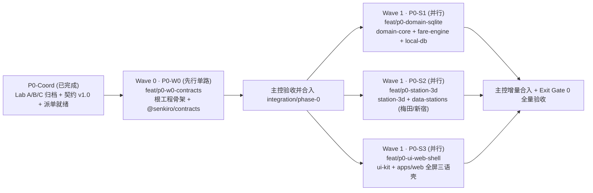

# Phase 0 执行总览与多工作树派单作战图（Wave 0 → Wave 1）

> **阶段目标**：筑牢 SENKIRO Alpha-SQLite Monorepo 骨架、冻结全域领域契约 v1.0、剥离东京硬编码、统一命令式 `Three.js` 车站 3D/2D 引擎、搭建同构 SQLite OPFS 存储与三语全屏应用壳。  
> **当前集成基线分支**：`integration/phase-0`  
> **交接总规程**：请先阅读 [HANDOFF_PROTOCOL.md](../HANDOFF_PROTOCOL.md) 与 [01-domain-contract-v1.0.md](../../01-domain-contract-v1.0.md)。

---

## 1. Wave 0 → Wave 1 依赖拓扑



> **关键执行顺序**：
> 1. **先只启动 `P0-W0`**（因 `P0-S1/S2/S3` 全部依赖根 `pnpm-workspace.yaml`、`tsconfig.base.json` 和 `@senkiro/contracts`）。
> 2. **`P0-W0` 完成并合入 `integration/phase-0` 后**，再同时新建 3 个工作树并行派发 **`P0-S1` + `P0-S2` + `P0-S3`**，三路零交集、零冲突！

---

## 2. Phase 0 四张派单书索引与当前状态

| 顺序 | Session | 当前状态 | 推荐 / 接力模型 | 工作树与分支（基于 `integration/phase-0`） | 独占路径 `ownedPaths` | 派单书 / 交接报告 |
| --- | --- | --- | --- | --- | --- | --- |
| **第 1 步（Wave 0）** | **P0-W0** | **✅ 已合并验收**（`75/75`） | Claude | `feat/p0-w0-contracts`（已合入） | 根工程配置 + `packages/contracts/**` | [p0-w0-contracts-brief.md](./p0-w0-contracts-brief.md) · [报告](../reports/p0-w0-contracts.md) |
| **第 2 步（Wave 1 并行）** | **P0-S1** | **✅ 已合并验收**（`domain-core` 47 + `fare-engine` 40 + `local-db` 12） | Claude → Codex | `feat/p0-domain-sqlite`（已合入） | `packages/{domain-core,fare-engine,local-db}/**` | [p0-s1-codex-relay.md](./p0-s1-codex-relay.md) · [报告](../reports/p0-s1-domain-sqlite.md) |
| **第 2 步（Wave 1 并行）** | **P0-S2** | **✅ 已合并验收**（`station-3d` 40 + `data-stations` 8） | Claude → Codex | `feat/p0-station-3d`（已合入） | `packages/{station-3d,data-stations}/**` | [p0-s2-codex-relay.md](./p0-s2-codex-relay.md) · [报告](../reports/p0-s2-station-3d.md) |
| **第 2 步（Wave 1 并行）** | **P0-S3** | **✅ 已合并验收**（`ui-kit` 27 + `web` 30） | Claude | `feat/p0-ui-web-shell`（已合入） | `packages/ui-kit/**` + `apps/web/**` | [p0-s3-ui-web-shell-brief.md](./p0-s3-ui-web-shell-brief.md) · [报告](../reports/p0-s3-ui-web-shell.md) |
| **第 3 步（Wave 2 收官）** | **P0-W2** | **🚀 可立即启动**（Exit Gate 0 联调） | **Claude** 或 **Codex** | `feat/p0-w2-exit-gate`（基于 `integration/phase-0`） | 契约上提 + `apps/web` 槽位接线 + Playwright E2E | [p0-w2-exit-gate-brief.md](./p0-w2-exit-gate-brief.md) |

---

## 3. 当前执行进度与下一步操作（Phase 0 终极收官 `P0-W2`）

Wave 0 与 Wave 1 三路已全部合入 `integration/phase-0`，全仓 **8 个项目、279 项单测全部通过**！请新建最后一个 Phase 0 联调工作树并启动 `P0-W2`：

```powershell
git -C "E:\SENKIRO" worktree add -b feat/p0-w2-exit-gate "E:\Workteree\SENKIRO\p0-w2-exit-gate" integration/phase-0
```

打开 [p0-w2-exit-gate-brief.md](./p0-w2-exit-gate-brief.md) 复制顶部提示词分发；`P0-W2` 合入并通过 Playwright E2E 后即达成 **Exit Gate 0**，可合并进 `main` 并开启 Phase 1（京阪神数据与京都站 3D）！
