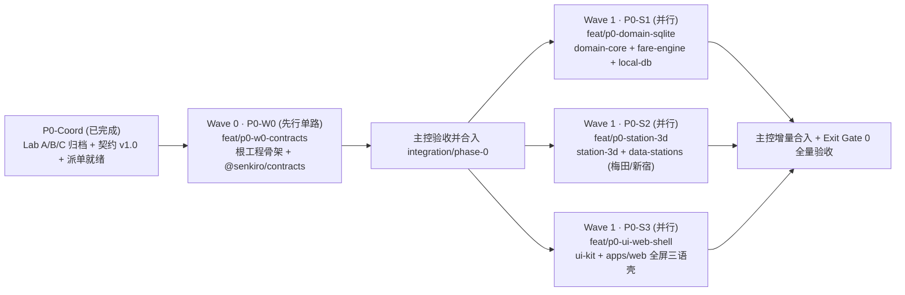

# Phase 0 执行总览与多工作树派单作战图（Wave 0 → Wave 1）

> **阶段目标**：筑牢 SENKIRO Alpha-SQLite Monorepo 骨架、冻结全域领域契约 v1.0、剥离东京硬编码、统一命令式 `Three.js` 车站 3D/2D 引擎、搭建同构 SQLite OPFS 存储与三语全屏应用壳。  
> **当前集成基线分支**：`integration/phase-0`  
> **交接总规程**：请先阅读 [HANDOFF_PROTOCOL.md](../HANDOFF_PROTOCOL.md) 与 [01-domain-contract-v1.0.md](../../01-domain-contract-v1.0.md)。

---

## 1. Wave 0 → Wave 1 依赖拓扑



> **关键执行顺序**：
> 1. **先只启动 `P0-W0`**（因 `P0-S1/S2/S3` 全部依赖根 `pnpm-workspace.yaml`、`tsconfig.base.json` 和 `@senkiro/contracts`）。
> 2. **`P0-W0` 完成并合入 `integration/phase-0` 后**，再同时新建 3 个工作树并行派发 **`P0-S1` + `P0-S2` + `P0-S3`**，三路零交集、零冲突！

---

## 2. Phase 0 四张派单书索引与订阅推荐

| 顺序 | Session | 推荐模型 | 新建分支（基于 `integration/phase-0`） | 独占路径 `ownedPaths` | 派单书（内含一键复制提示词） |
| --- | --- | --- | --- | --- | --- |
| **第 1 步（Wave 0）** | **P0-W0** | **GPT / Codex** 或 **Gemini** | `feat/p0-w0-contracts` | 根工程配置文件 + `packages/contracts/**` + 报告 | [p0-w0-contracts-brief.md](./p0-w0-contracts-brief.md) |
| **第 2 步（Wave 1 并行）** | **P0-S1** | **GPT / Codex** | `feat/p0-domain-sqlite` | `packages/{domain-core,fare-engine,local-db}/**` + 报告 | [p0-s1-domain-sqlite-brief.md](./p0-s1-domain-sqlite-brief.md) |
| **第 2 步（Wave 1 并行）** | **P0-S2** | **GPT / Codex** 或 **Gemini** | `feat/p0-station-3d` | `packages/{station-3d,data-stations}/**` + 报告 | [p0-s2-station-3d-brief.md](./p0-s2-station-3d-brief.md) |
| **第 2 步（Wave 1 并行）** | **P0-S3** | **Claude** | `feat/p0-ui-web-shell` | `packages/ui-kit/**` + `apps/web/**` + 报告 | [p0-s3-ui-web-shell-brief.md](./p0-s3-ui-web-shell-brief.md) |

---

## 3. Morii 手动启动操作四步曲

1. **打开 `P0-W0` 派单书**，用以下指令从最新的 `integration/phase-0` 新建工作树：
   ```powershell
   git -C "E:\SENKIRO" worktree add -b feat/p0-w0-contracts "E:\Workteree\SENKIRO\p0-w0-contracts" integration/phase-0
   ```
2. **在新工作树打开编码 Agent**，直接全选复制 `p0-w0-contracts-brief.md` 顶部的「📋 一键复制启动提示词」粘贴发送。
3. **`P0-W0` 提交报告后，回到本主控 Session** 告知合并；主控核验并 `--no-ff` 合入 `integration/phase-0`。
4. **同时新建 Wave 1 三个工作树**（务必基于合入 `P0-W0` 后的 `integration/phase-0`）：
   ```powershell
   git -C "E:\SENKIRO" worktree add -b feat/p0-domain-sqlite "E:\Workteree\SENKIRO\p0-domain-sqlite" integration/phase-0
   git -C "E:\SENKIRO" worktree add -b feat/p0-station-3d "E:\Workteree\SENKIRO\p0-station-3d" integration/phase-0
   git -C "E:\SENKIRO" worktree add -b feat/p0-ui-web-shell "E:\Workteree\SENKIRO\p0-ui-web-shell" integration/phase-0
   ```
   分别粘贴 `p0-s1`、`p0-s2`、`p0-s3` 提示词并发推进，完成后依次回主控合入并执行 `Exit Gate 0` 全仓验收！
