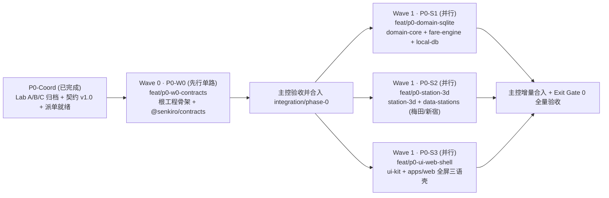

# Phase 0 执行总览与多工作树派单作战图（Wave 0 → Wave 1）

> **阶段目标**：筑牢 SENKIRO Alpha-SQLite Monorepo 骨架、冻结全域领域契约 v1.0、剥离东京硬编码、统一命令式 `Three.js` 车站 3D/2D 引擎、搭建同构 SQLite OPFS 存储与三语全屏应用壳。  
> **当前集成基线分支**：`integration/phase-0`  
> **交接总规程**：请先阅读 [HANDOFF_PROTOCOL.md](../HANDOFF_PROTOCOL.md) 与 [01-domain-contract-v1.0.md](../../01-domain-contract-v1.0.md)。

---

## 1. Wave 0 → Wave 1 依赖拓扑



> **关键执行顺序**：
> 1. **先只启动 `P0-W0`**（因 `P0-S1/S2/S3` 全部依赖根 `pnpm-workspace.yaml`、`tsconfig.base.json` 和 `@senkiro/contracts`）。
> 2. **`P0-W0` 完成并合入 `integration/phase-0` 后**，再同时新建 3 个工作树并行派发 **`P0-S1` + `P0-S2` + `P0-S3`**，三路零交集、零冲突！

---

## 2. Phase 0 四张派单书索引与当前状态

| 顺序 | Session | 当前状态 | 推荐模型 | 新建分支（基于 `integration/phase-0`） | 独占路径 `ownedPaths` | 派单书 |
| --- | --- | --- | --- | --- | --- | --- |
| **第 1 步（Wave 0）** | **P0-W0** | **✅ 已合并验收**（`75/75` 通过） | Claude / GPT | `feat/p0-w0-contracts` | 根工程配置 + `packages/contracts/**` + 报告 | [p0-w0-contracts-brief.md](./p0-w0-contracts-brief.md) |
| **第 2 步（Wave 1 并行）** | **P0-S1** | **🚀 可立即启动** | **GPT / Codex** | `feat/p0-domain-sqlite` | `packages/{domain-core,fare-engine,local-db}/**` + `pnpm-lock.yaml` + 报告 | [p0-s1-domain-sqlite-brief.md](./p0-s1-domain-sqlite-brief.md) |
| **第 2 步（Wave 1 并行）** | **P0-S2** | **🚀 可立即启动** | **GPT / Codex** 或 **Gemini** | `feat/p0-station-3d` | `packages/{station-3d,data-stations}/**` + `pnpm-lock.yaml` + 报告 | [p0-s2-station-3d-brief.md](./p0-s2-station-3d-brief.md) |
| **第 2 步（Wave 1 并行）** | **P0-S3** | **🚀 可立即启动** | **Claude** | `feat/p0-ui-web-shell` | `packages/ui-kit/**` + `apps/web/**` + `pnpm-lock.yaml` + 报告 | [p0-s3-ui-web-shell-brief.md](./p0-s3-ui-web-shell-brief.md) |

---

## 3. 当前执行步骤（Wave 1 三路并行启动）

`P0-W0` 已合入 `integration/phase-0` 并通过主控验证。请立即基于最新 `integration/phase-0` 同时创建以下 3 个独立工作树：

```powershell
git -C "E:\SENKIRO" worktree add -b feat/p0-domain-sqlite "E:\Workteree\SENKIRO\p0-domain-sqlite" integration/phase-0
git -C "E:\SENKIRO" worktree add -b feat/p0-station-3d "E:\Workteree\SENKIRO\p0-station-3d" integration/phase-0
git -C "E:\SENKIRO" worktree add -b feat/p0-ui-web-shell "E:\Workteree\SENKIRO\p0-ui-web-shell" integration/phase-0
```

分别复制对应派单书顶部的「📋 一键复制启动提示词」并发分发；三路全部完成后依次回主控合入并执行 `Exit Gate 0` 全仓联调验收！
