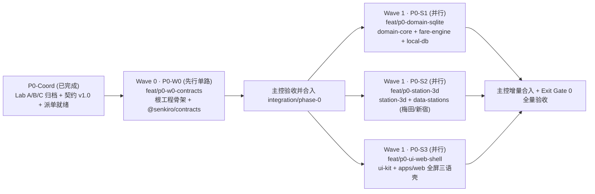

# Phase 0 执行总览与多工作树派单作战图（Wave 0 → Wave 1）

> **阶段目标**：筑牢 SENKIRO Alpha-SQLite Monorepo 骨架、冻结全域领域契约 v1.0、剥离东京硬编码、统一命令式 `Three.js` 车站 3D/2D 引擎、搭建同构 SQLite OPFS 存储与三语全屏应用壳。  
> **当前集成基线分支**：`integration/phase-0`  
> **交接总规程**：请先阅读 [HANDOFF_PROTOCOL.md](../HANDOFF_PROTOCOL.md) 与 [01-domain-contract-v1.0.md](../../01-domain-contract-v1.0.md)。

---

## 1. Wave 0 → Wave 1 依赖拓扑

> **关键执行顺序**：
> 1. **先只启动 `P0-W0`**（因 `P0-S1/S2/S3` 全部依赖根 `pnpm-workspace.yaml`、`tsconfig.base.json` 和 `@senkiro/contracts`）。
> 2. **`P0-W0` 完成并合入 `integration/phase-0` 后**，再同时新建 3 个工作树并行派发 **`P0-S1` + `P0-S2` + `P0-S3`**，三路零交集、零冲突！

---

## 2. Phase 0 四张派单书索引与当前状态

| 顺序 | Session | 当前状态 | 推荐 / 接力模型 | 工作树与分支（基于 `integration/phase-0`） | 独占路径 `ownedPaths` | 派单书 / 交接报告 |
| --- | --- | --- | --- | --- | --- | --- |
| **第 1 步（Wave 0）** | **P0-W0** | **✅ 已合并验收**（`75/75`） | Claude | `feat/p0-w0-contracts`（已合入） | 根工程配置 + `packages/contracts/**` | [p0-w0-contracts-brief.md](./p0-w0-contracts-brief.md) · [报告](../reports/p0-w0-contracts.md) |
| **第 2 步（Wave 1 并行）** | **P0-S1** | **✅ 已合并验收**（`domain-core` 47 + `fare-engine` 40 + `local-db` 12） | Claude → Codex | `feat/p0-domain-sqlite`（已合入） | `packages/{domain-core,fare-engine,local-db}/**` | [p0-s1-codex-relay.md](./p0-s1-codex-relay.md) · [报告](../reports/p0-s1-domain-sqlite.md) |
| **第 2 步（Wave 1 并行）** | **P0-S2** | **✅ 已合并验收**（`station-3d` 40 + `data-stations` 8） | Claude → Codex | `feat/p0-station-3d`（已合入） | `packages/{station-3d,data-stations}/**` | [p0-s2-codex-relay.md](./p0-s2-codex-relay.md) · [报告](../reports/p0-s2-station-3d.md) |
| **第 2 步（Wave 1 并行）** | **P0-S3** | **✅ 已合并验收**（`ui-kit` 27 + `web` 30） | Claude | `feat/p0-ui-web-shell`（已合入） | `packages/ui-kit/**` + `apps/web/**` | [p0-s3-ui-web-shell-brief.md](./p0-s3-ui-web-shell-brief.md) · [报告](../reports/p0-s3-ui-web-shell.md) |
| **第 3 步（Wave 2 收官）** | **P0-W2** | **✅ 已合并验收**（全仓 `307/307` + E2E `10/10`） | Claude | `feat/p0-w2-exit-gate`（已合入 `eb77275`） | 契约上提 + `apps/web` 槽位接线 + Playwright E2E | [p0-w2-exit-gate-brief.md](./p0-w2-exit-gate-brief.md) · [报告](../reports/p0-w2-exit-gate.md) |

---

## 3. 当前执行进度：Exit Gate 0 通过，Phase 0 收官

Phase 0 五条分支已全部合入 `integration/phase-0`。主控在合入点 `eb77275` 清缓存复跑：Biome 201 文件 0 错误 0 警告，8 个项目 typecheck / 构建全部通过，全仓 **307 项单测**全绿，Playwright Exit Gate 0 **10/10** 通过（硬件 GPU WebGL）。`integration/phase-0` 已以 `--no-ff` 合并进 `main`。

**下一步**：基于合并后的 `main` 创建 `integration/phase-1`，由 `P1-Coord` 冻结关西 ID 注册表、`PMTiles` 图层规范与许可矩阵，并生成 `docs/dispatch/phase-1/` 三份派单书（`P1-S1` 京阪神数据、`P1-S2` Atlas UI、`P1-S3` 京都站 3D）。下方 §4 的遗留项按 `ownedPaths` 分拣并入对应派单。

---

## 4. P0-W2 验收审查遗留项（移交 Phase 1）

来源：主控合入后对 `b413683...46df3be` 的四路只读审查，每条均经审查者尝试反驳后保留；第 1 条另经主控在 `vite preview` 生产页实测。均不阻断 Exit Gate 0。

### 4.1 应在 Phase 1 修复

| # | 归属路径 | 问题 | 建议处理 |
| --- | --- | --- | --- |
| 1 | `packages/ui-kit/**` + `apps/web/src/main.tsx` | `ui-kit` 的 `index.ts` 在 `"sideEffects": ["**/*.css"]` 下被视为无副作用，入口里的 `tokens.css` 与 `base.css` 都被生产构建丢弃。P0-W2 只补回令牌；生产页仍缺 `base.css`：`body` 8px 边距与纵向滚动、`content-box`、按钮字体回退 Arial、无 `:focus-visible` 焦点框、无中日文断行规则。`ui-kit` 的 `exports` 未暴露 `./base.css`，`apps/web` 无法单侧修复。 | `ui-kit` 暴露 `./base.css`（或将入口标记为有副作用 / 提供显式样式入口），`apps/web` 显式导入；E2E 增加生产页 `body` 边距与 `box-sizing` 断言。 |
| 2 | `apps/web/tests/e2e/**` | 窄屏用例 #7–#10 只断言 `documentElement.scrollWidth <= innerWidth`，而地图、Dock、快速入口与抽屉内容均为 `position: fixed`，不计入根滚动宽度，用例无法失败。 | 改为对 `[role=dialog]`、`[data-station-explorer]`、`[data-local-db-probe]` 内元素做 `getBoundingClientRect().right <= innerWidth`，或检查抽屉 `.body` 的 `scrollWidth <= clientWidth`。 |
| 3 | `apps/web/src/i18n/messages.ts` + `packages/local-db/src/sqlite.worker.ts` | `memory-fallback` 三语文案一律写“此浏览器不支持 OPFS 同步访问句柄”。Worker 在安装 SAH-pool 失败时（含另一标签页占用句柄）统一降级且丢弃原因，跨标签页场景下文案归因错误。 | Worker 回传降级原因；文案区分“不支持”与“被其他标签页占用”。 |

### 4.2 小问题（可随相关派单顺手处理）

1. `packages/fare-engine/src/route.ts:81`：`isFareRuleRejection` 更严格后，缺 `reason` 或状态拼错的拒绝对象会被当作路线计划继续计价（旧代码会转成 `ERROR`）。类型正确的规则包触发不到，但与 fail-closed 原则相悖：任何带 `status` 的对象都应视为拒绝，守卫只用于区分转发还是转为 `ERROR`。
2. `packages/fare-engine/src/pack.ts:23`：`@deprecated FareRoutingOptions` 已不兼容 P0-S1 的 `search` 字段，模块注释却称旧代码可照常编译；删除别名或在注释中写明形状变化。
3. `packages/station-3d/src/ui/StationExplorer.tsx:145`：外部（浏览器前进/后退）改变 `level` 只隐藏分层展开视图，不重置 `explodedState`，回到“全部楼层”时展开视图会重新出现；注释所说“关闭”与行为不符。
4. `apps/web/src/slots/adapters/local-db-probe.tsx:208`：数据库打开后 `readStatus` 失败未被处理，探针停在“正在打开…”；写入 / 清空 / 导出失败统一显示“无法打开数据库”并移除全部按钮。
5. `apps/web/src/modules/JourneyModule.tsx:33`（及 `ProfileModule.tsx:42`）：本地数据库探针的 `SlotBoundary` 沿用枢纽视图的加载 / 错误文案（“正在加载枢纽视图…”）。
6. `apps/web/tests/slots-integration.test.tsx:132`：“从 URL 恢复选中设施”的断言 `?.textContent).not.toBe('')` 在元素缺失时同样通过；E2E 有等价的有效断言。
7. `apps/web/src/shell/HubPanel.tsx:43`：`SlotBoundary` 未按枢纽加 `key`，一个枢纽加载失败后在抽屉打开状态下切换到另一枢纽仍显示错误；加 `key={hub.id}` 即可。
8. `apps/web/vite.config.ts:27`：`chunkSizeWarningLimit: 1200` 会掩盖“three.js 适配器被静态引入外壳主块”（约 1,082 kB）这类回归，宜改为针对入口块的体积断言。
9. `apps/web/tests/e2e/exit-gate-0.spec.ts:210`：京都零请求用例缺正向对照（未确认梅田 / 新宿确实请求了匹配同一正则的块名）。
10. 同文件三语用例：刷新后只复核 `lang`、`data-theme` 与标题，未如报告所述再次断言令牌值与 URL。
