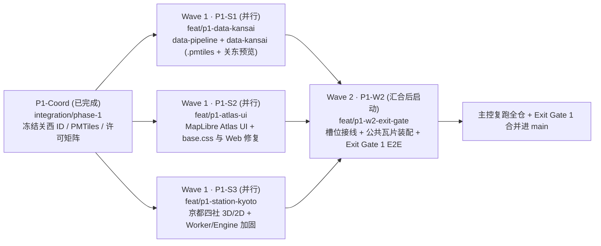

# Phase 1 执行总览与多工作树派单作战图（`SENKIRO Atlas`）

> **阶段目标**：筑牢京阪神 8 社空间数据脊梁与离线 `PMTiles` 矢量图鉴（含关东预览区切换）、落地京都站四社复合体 3D/2D 室内导航模型，打通「宏观线路地图 ↔ 梅田/京都/新宿 3D 枢纽」双向深链下钻，并顺手清零 Phase 0 `P0-W2` 移交的全部遗留修复。  
> **当前集成基线分支**：`integration/phase-1`（基于 `main@0f7b764`）  
> **技术规范与冻结 ID 注册表**：[docs/02-phase1-atlas-spec.md](../../02-phase1-atlas-spec.md)  
> **交接总规程**：[HANDOFF_PROTOCOL.md](../HANDOFF_PROTOCOL.md)

---

## 1. Wave 1（三路直发零冲突）→ Wave 2 依赖拓扑

> **架构评估结论（跳过 `P1-W0`）**：`main@0f7b764` 上的 `@senkiro/contracts` v1.0（含 `P0-W2` 上提字段）与 `@senkiro/station-3d`（已含 `onNavigateExternalLine`）已完整覆盖 Phase 1 所需全部契约类型；跨包数据通过 `apps/web/src/slots/slots.tsx` 新增 `AtlasDataSourceSlot` 解耦。因此 **无需增开 `P1-W0` 代码波次**，Wave 1 三路工作树可直接基于 `integration/phase-1` 同时启动！

---

## 2. Phase 1 派单索引与 `ownedPaths` 零重叠核验矩阵

| 波次 | Session | 推荐模型 | 分支（Base: `integration/phase-1`） | 建议工作树路径 | 独占路径 `ownedPaths` | 状态 | 派单书 |
| --- | --- | --- | --- | --- | --- | --- | --- |
| **Wave 0** | **P1-Coord** | Gemini（主控） | `integration/phase-1` | `E:\SENKIRO\worktrees\integration-phase-1` | `docs/**`（仅文档与调度） | **✅ 已就绪** | [02-phase1-atlas-spec.md](../../02-phase1-atlas-spec.md) |
| **Wave 1** | **P1-S1** `[REP-02]` | Gemini | `feat/p1-data-kansai` | `E:\Workteree\SENKIRO\p1-data-kansai` | `packages/data-pipeline/**`, `packages/data-kansai/**`, `pnpm-lock.yaml`, `docs/dispatch/reports/p1-s1-data-kansai.md` | **⏳ 已交付，待主控核验** | [p1-s1-data-kansai-brief.md](./p1-s1-data-kansai-brief.md) |
| **Wave 1** | **P1-S2** | Claude | `feat/p1-atlas-ui` | `E:\Workteree\SENKIRO\p1-atlas-ui` | `packages/ui-kit/**`, `apps/web/**`, `pnpm-lock.yaml`, `docs/dispatch/reports/p1-s2-atlas-ui.md` | **✅ 已合并验收**（`82ea02a`，全仓 `364/364` + E2E `20/20`） | [p1-s2-atlas-ui-brief.md](./p1-s2-atlas-ui-brief.md) · [报告](../reports/p1-s2-atlas-ui.md) |
| **Wave 1** | **P1-S3** `[REP-01]` | GPT / Codex | `feat/p1-station-kyoto` | `E:\Workteree\SENKIRO\p1-station-kyoto` | `packages/data-stations/**`, `packages/station-3d/**`, `packages/local-db/**`, `packages/fare-engine/**`, `docs/dispatch/reports/p1-s3-station-kyoto.md` | **▶ 二期精修中** | [p1-s3-station-kyoto-brief.md](./p1-s3-station-kyoto-brief.md) · [Sol 深度指南](./p1-s3-sol-master-guide.md) |
| **Wave 2** | **P1-W2** | Claude / Gemini | `feat/p1-w2-exit-gate` | `E:\Workteree\SENKIRO\p1-w2-exit-gate` | `apps/web/**`, `packages/data-kansai/**`, `docs/dispatch/reports/p1-w2-exit-gate.md` | **⏸ 等 Wave 1 合入** | [p1-w2-exit-gate-brief.md](./p1-w2-exit-gate-brief.md) |

> **零重叠核验**：Wave 1 三路（`P1-S1` / `P1-S2` / `P1-S3`）各自独占完全不相交的 `packages/*`、`apps/*` 与 `reports/*` 路径（`pnpm-lock.yaml` 按总规程仅允许各自增删依赖时自动更新，若汇合时冲突由主控执行 `pnpm install --lockfile-only` 消解）。

---

## 3. `P0-W2` 验收遗留项（3 项必修 + 10 项小改进）分拣落位表

| 来源序号 | 事项摘要 | 归属路径 | Phase 1 接单人 |
| --- | --- | --- | --- |
| **必修 #1** | `@senkiro/ui-kit` 暴露 `./base.css` 并在 `apps/web/src/main.tsx` 显式导入 + E2E 断言 `margin: 0` 与 `border-box` | `packages/ui-kit/**` + `apps/web/**` | **`P1-S2`** |
| **必修 #2** | 窄屏 E2E（#7–#10）从根 `scrollWidth` 改为 `[role=dialog]` 等 `position: fixed` 元素级右边界断言 | `apps/web/tests/e2e/**` | **`P1-S2`** |
| **必修 #3** | `local-db` Worker 回传降级原因（`unsupported` / `pool-busy`），Web 三语文案准确区分“不支持”与“被其他标签页占用” | `packages/local-db/**`（Worker）+ `apps/web/**`（文案/展示） | **`P1-S3`（Worker）+ `P1-S2`（UI 文案）** |
| **小项 #1** | `packages/fare-engine/src/route.ts:81`：任意带 `status` 的拒绝对象必须 fail-closed 阻断计价 | `packages/fare-engine/**` | **`P1-S3`** |
| **小项 #2** | `packages/fare-engine/src/pack.ts:23`：更正 `@deprecated FareRoutingOptions` 形状变更注释或清理说明 | `packages/fare-engine/**` | **`P1-S3`** |
| **小项 #3** | `packages/station-3d/src/ui/StationExplorer.tsx:145`：外部切换楼层非空时同步重置 `explodedState` | `packages/station-3d/**` | **`P1-S3`** |
| **小项 #4** | `apps/web/src/slots/adapters/local-db-probe.tsx:208`：`readStatus` 异常捕获与写入/清空/导出失败时保留操作按钮 | `apps/web/**` | **`P1-S2`** |
| **小项 #5** | `apps/web/src/modules/JourneyModule.tsx` & `ProfileModule.tsx`：探针使用独立加载/报错文案，不沿用枢纽文案 | `apps/web/**` | **`P1-S2`** |
| **小项 #6** | `apps/web/tests/slots-integration.test.tsx:132`：修复可选链断言缺失元素仍通过的问题 | `apps/web/tests/**` | **`P1-S2`** |
| **小项 #7** | `apps/web/src/shell/HubPanel.tsx:43`：`SlotBoundary` 增加 `key={hub.id}` 防止错误状态跨枢纽残留 | `apps/web/src/shell/**` | **`P1-S2`** |
| **小项 #8** | `apps/web/vite.config.ts:27`：增加对主入口 chunk 体积的显式预算检查（防 `three`/`maplibre-gl` 意外打入主块） | `apps/web/**` | **`P1-S2`** |
| **小项 #9** | `apps/web/tests/e2e/exit-gate-0.spec.ts:210`：枢纽 chunk 零请求用例补齐正向对照断言 | `apps/web/tests/e2e/**` | **`P1-S2`** |
| **小项 #10** | `exit-gate-0.spec.ts` 三语刷新用例补全令牌 CSS 变量值与 URL 参数复核 | `apps/web/tests/e2e/**` | **`P1-S2`** |
| **P2 补充** | `apps/web` E2E 增测 Firefox、WebKit 与无 GPU 软件渲染降级路径 | `apps/web/tests/e2e/**` | **`P1-W2`（Exit Gate 1）** |

> 注：`LocalDb` 探针合成行（`dataNature === 'synthetic'`）排除测试保留移交 Phase 3 `P3-S1`。
>
> **进度（2026-11-28 · `82ea02a`）**：`P1-S2` 名下的必修 #1、#2、#3（Web 文案侧）与小项 #4–#10 已随 `feat/p1-atlas-ui` 合入。#3 的 Worker 侧仍由 `P1-S3` 交付；在此之前，旧驱动不回传原因时 Web 显示“存储层未报告回退原因”。

---

## 4. Exit Gate 1 验收标准（Phase 1 收官条件）

1. 全仓 `pnpm check && pnpm build && pnpm test` 全绿（`Biome 2.6.9` 0 错误 0 警告、`TS 7.0.2` 严格编译通过）。
2. 京阪神 8 社空间数据通过 `TrackGraphIndex.issues.length === 0` 与 `assertOdbLIsolation`；`kansai-rail.pmtiles`、`kanto-rail.pmtiles` 及物理隔离 `kanto-rail-vertical.odbl.pmtiles` 全部可由 `pmtiles` v4 读取验证。
3. 搜索「大阪」「梅田」「京都」「河原町」「祇園四条」准确区分全部独立站与复合体（`sk:complex:kansai:kyoto` 严格仅含 JR西日本 / JR東海 / 近鉄 / 地下鉄烏丸線 4 站，绝不混入河原町/祇園四条）。
4. 梅田 7 站、京都 4 社、新宿 10 站均可在浏览器内流畅运行命令式 3D / 2D 横向分栏图与无台阶寻路，并与 Atlas 宏观地图双向 URL 深链联动。
5. Playwright Exit Gate 1 E2E（含 Chromium + Firefox + WebKit + 软件渲染降级路径）全绿，主控以 `--no-ff` 合并 `integration/phase-1` 进 `main` 并推送远端。

---

## 5. Wave 1 合入记录与移交 `P1-W2` 的事项

### 5.1 `P1-S2` 合入核验（2026-11-28 · 主控 Claude）

- 合入点 `82ea02a`（`--no-ff`，来源 `feat/p1-atlas-ui@fe03b3d`，最后代码提交 `7dd4690`）。41 个改动文件全部落在 `ownedPaths`；无密钥、`.env`、`raw/`、`.zip`、`.pmtiles` 或图片入库；`apps/web` 未导入 `@senkiro/data-kansai` 与京都数据；除 `useAppSearch()` 自身实现外无裸 `useSearch()`。`pnpm-lock.yaml` 新增项仅为 `maplibre-gl@5.24.1`、`pmtiles@4.5.0` 及其纯 JS 依赖。
- 主控在合入点清缓存复跑：Biome 220 文件 0 错 0 警，8 个项目 typecheck / build 全部通过，全仓 **364/364** 单测（`ui-kit` 31、`web` 94，其余与基线相同），Playwright **20/20**（硬件 GPU：ANGLE / RTX 4080 Laptop D3D11）。生产入口 + 静态依赖 172.7 kB gzip（预算 200 kB）。
- 主控目视 E2E 截图：MapLibre 无字体 / 图标 / 底图服务器时离线绘出线、站、站号与 “3D” 徽章；预览夹具在地图状态栏与 Atlas 面板均标为合成数据；京都复合体条目醒目列出“不含（防误并）”。

### 5.2 移交 `P1-W2` 的接线与收尾事项

1. **正式数据源接线**：按 [p1-s2 报告 §6](../reports/p1-s2-atlas-ui.md) 在 `registry.ts` 挂 `@senkiro/data-kansai` provider（导出名以 `P1-S1` 实际为准），`.pmtiles` 放 `apps/web/public/tiles/`；接线后改写或删除 `atlas.spec.ts` 中“无数据源时不加载 MapLibre chunk”一条。
2. **预览注入口**：`window.__SENKIRO_ATLAS_PREVIEW__` 目前在生产构建中同样生效（注入数据一律标为预览）。正式 provider 接入后决定：保留为带标注的测试入口，或限定为非生产构建。
3. **真实瓦片与地图点击**：补浏览器内加载真实 `kansai-rail.pmtiles` 的 E2E，以及地图画布点击拾取（徽章 → `hub + complex`，站 → `station`，线 → `line`）的端到端断言。Wave 1 只跑过内联 GeoJSON 路径，点击拾取只有单测。
4. **OPFS 回退原因**：`P1-S3` 合入后，把 `exit-gate-0.spec.ts` 内存回退用例从接受 `'unreported' | 'unsupported'` 收紧为只接受 `'unsupported'`，并完成双标签页 `pool-busy` E2E。
5. **地图字形抽查**：截图中简中站名 `京都站（JR西日本）` 的全角括号疑似未正确绘制（MapLibre 未设 `glyphs` 时由本地 TinySDF 绘字）。接入真实数据后在三语下各截一张图复核，必要时调整标签文本或字体栈。
6. **防误并说明的语言**：契约 `StationComplex.explicitlyExcluded[].reason` 是单语 `string`，简中界面会直接显示数据中的原文（夹具为英文）。待 `P1-S1` 核验时确认其 `reason` 的书写语言；若需三语，由主控评估是否在契约 §7 增补可选的 `reasonNames?: LocalizedNames`。
