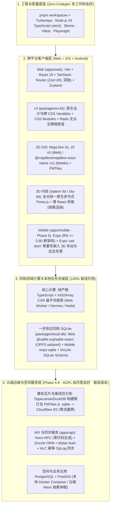
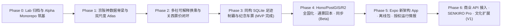

# SENKIRO 主线开发总规划与多智能体并行路线图（Master Plan v1.0）

> **正式品牌名称**：`SENKIRO`（センキロ｜線・記・路 — *Every line, a story.*）  
> **文档版本**：`v1.0` · 2026-11-27（Gate 0 全部决策已由 Morii 正式拍板锁定）  
> **总体规划与主控调度（Chief Coordinator）**：Gemini（Antigravity 主工作区）  
> **协同计算资源**：Gemini 订阅（\$20/月）+ Claude Pro（\$20/月）+ ChatGPT Plus / Codex（\$20/月）  
> **前置历史输入文档**：[plan-v0.1.md](./plan-v0.1.md)（保留原文作历史参考）、[00-shared-contract.md](./00-shared-contract.md)、[brand-v1.0.md](./brand-v1.0.md)、[TRADEMARKS.md](../TRADEMARKS.md)。主线正式开发一律以本 `v1.0` 规划及后续升级的 `v1.0` 领域契约为准。

---

## 0. 已拍板全局基准与技术总纲（Gate 0 Locked Decisions）

### 0.1 五大立项决策定案（D-01 ～ D-05）

| 决策项 | 正式锁定结论 |
| --- | --- |
| **D-01 · 原型收拢与主干策略** | 先将散落的工作树分支（`integration/atlas-v2`、`umeda-sol`、`claude/shinjuku-3d-*`）分别收拢归档至 `lab/a-tokyo-atlas-fare`、`lab/b-umeda-3d`、`lab/c-shinjuku-3d` 作为永久只读历史基准保留；`main` 直接建立干净的 `packages/* + apps/*` Monorepo，将验证合格的核心资产重构迁入正式包。 |
| **D-02 · 首发区域与首页形态** | 主线首发聚焦 **「京阪神核心圈（大阪/梅田—京都—难波/神户，配齐梅田 + 京都双 3D 枢纽）」** 跑通全闭环，同时将已验证的 **「东京 23 区 + 新宿 3D」作为内置第二切换区域（关东预览区）** 挂载进同一套架构；首页默认采用 **「全屏铁道地图底板 + 左上悬浮出行搜索与五大模块导航」**。 |
| **D-03 · 数据许可与商业 API 节奏** | **商业运价/时刻 API（如駅すぱあと / ODPT 商业许可）统一在 Phase 6（商业化 V1）引入**。Phase 1–5 全程执行「公开可再分发数据与人工核对官方规则条文入库 + 受限网页时刻表仅本地 `.gitignore` 构建」双层制，零商业 API 订阅成本完成 MVP、Beta 与三端开发。 |
| **D-04 · 全栈技术基线（Alpha-SQLite）** | 采用 **零锁定精益全栈 + 一步到位同构 SQLite + 原生命令式 Three.js + Expo 新架构 `"use dom"`**（完整清单见 §0.3）。 |
| **D-05 · 一级多语言标准** | 自 Phase 0 起确立 **简体中文 / 日语 / 英语（`zh-CN` / `ja` / `en`）** 三语一级标准；未核实译名的专有实体诚实回退日语原文，绝不机翻编造。 |

### 0.2 三项 SENKIRO Lab 前行实验真实基线（修正 11-21 旧快照）

| 原型代号 | 归档目标分支 | 已验证成果与实测基线 | 迁入主线的核心资产 |
| --- | --- | --- | --- |
| **Lab A** 东京铁路图鉴 + JR 运价 + 3D 都市地下网 | `lab/a-tokyo-atlas-fare`（合入 `integration/atlas-v2` 及 Ghost-Surface 提交） | 15 运营商、40 线路、481 站、503 区段；MapLibre 2D + Three.js 23 区 145 分块三维城市与地下开削系统；支持 2026-03-14 运价改定双版本的纯 TS 运价引擎；Vitest `83/83`、Playwright `14/14` 通过。 | 三图分离内核、650m 跨源对齐守卫、ODbL 集合数据库物理隔离机制、6 态可解释运价引擎、都市分块与车体程序化生成器，以及 **1 主控 + 5 工作树零冲突波次集成范式**。 |
| **Lab B** 大阪・梅田七站复合体 + Whity 3D/2D | `lab/b-umeda-3d`（审计清理并合入 `umeda-sol` 最新候选树） | 覆盖 JR 大阪（含うめきた）、御堂筋梅田、东梅田、西梅田、阪急大阪梅田、阪神大阪梅田、JR 北新地 + Whity 地下街（20 层归并 6 层、171 节点、194 连接、9 款关西车型、3 次 Draw Call 命令式 InstancedMesh、横向共享比例尺 2D 分图、中日英三语）；Vitest `71/71`、Playwright `57/57`、`58,482` 路线对不变量通过。 | **直接搞定大阪—京都首发走廊最复杂的梅田七站枢纽数据与建筑资产**；确立了统一 `selection` 状态与命令式 Three.js 零重渲染交互模型。 |
| **Lab C** 新宿站群 10 层 3D/2D + 大新宿时刻表管线 | `lab/c-shinjuku-3d`（合入 `claude/shinjuku-3d-indoor-nav-3f3cce`） | 新宿八站区 + 新宿三丁目 + 新宿西口（23 楼层归并 10 层、409 节点、1,066 边）、字典序无台阶寻路、横向分栏 2D 平面图、站台门联动，以及零依赖时刻表构建管线（公开 CC BY 层 + 本地隔离层）；Vitest `260` 项通过。 | 复杂枢纽室内拓扑校验标准、2D 横向分栏算法、站内建筑规则几何生成函数（Phase 0 剥离 R3F 合入命令式 Three.js），以及标准时刻表归一化管线。 |

### 0.3 正式锁定的全栈技术规范（Alpha-SQLite 架构）

### 0.4 全产品「五图同源、五端联动」数据流

1. **五张严格分离但同源对齐的领域图**（均携带 `SourceRecord` 溯源与 `validFrom / validTo` 有效期）：
   - `TrackGraph`（物理轨道区段与里程：`Operator / RailLine / TrackSegment / Station`）
   - `StationGraph`（站内多楼层三维空间：`StationComplex / Level / Place / Gate / Link`）
   - `ServiceGraph`（运营系统、车次时刻与跨社直通：`ServicePattern / Trip / ThroughService`）
   - `FarePassGraph`（版本化运价条文、座席附加费与通票规则：`FareRule / Tariff / PassEligibility`）
   - `JourneyGraph`（个人四维制霸记录与纪念收藏：`RideRecord / RideSegment / VisitedStation / MunicipalityVisit / CommemorativeTicket`）
2. **五大一级产品模块（`SENKIRO` 主导航）**：
   - **`Atlas`（地图与铁道百科）** ↔ **`Route`（多社可解释换乘比较）** ↔ **`Tickets`（票价拆解、通票回本与数字车票博物馆）** ↔ **`Journey`（区间点亮与全日本制霸）** ↔ **`Profile`（本地数据主权、多端同步与 `SENKIRO Pro`）**。

---

## 1. 主控调度架构与三大 \$20 订阅协同规程

### 1.1 「一主控 + 多工作树波次」隔离开发纪律

1. **主控平面（Chief Coordinator —— Gemini 主工作区）**：
   - 独家掌管集成切面分支（`integration/phase-X` 与 `main`）、根级工程配置（`package.json`、`pnpm-workspace.yaml`、`turbo.json`、`biome.json`、`tsconfig.base.json`）、共享契约包（`packages/contracts/**`）、顶层应用路由接线及状态快照（`docs/status/project-status.json`）。
   - 每个阶段按 **Wave 0（冻结契约 + 生成 `docs/dispatch/phase-X/<session>-brief.md` 自包含派单书） → Parallel Sessions（独立工作树并行开发） → Incremental Wave Merges（主控 `--no-ff` 增量合并与接线） → Exit Gate（全量构建/单测/E2E/截图/合规验收）** 闭环推进。
2. **专职工作树硬性铁律（Zero Cross-Zone Edits）**：
   - 每个并行 Session 运行在独立 Git Worktree（`worktrees/p<X>-<module>/`，分支 `feat/p<X>-<module>`），**严禁修改派单书 `ownedPaths` 以外的任何文件**。
   - 需要新增跨包类型或接口时，写入 `docs/dispatch/reports/<session>.md` 的 `## Contract Requests` 提交，由主控统一升级契约后再 `git merge integration/phase-X`。
   - 所有依赖选型已确保**零代码生成（Zero-Codegen）**，切分支后直接 `pnpm typecheck && pnpm test` 即可验证，无生成物冲突。

### 1.2 三大 \$20 订阅特长分工与「95% 配额安全接力」机制

| 订阅模型 | 指定核心职责 | 额度保护禁令（严禁消耗配额的场景） |
| --- | --- | --- |
| **Gemini** （\$20 · Antigravity） | **1. 全局主控与波次集成接线**； **2. GIS 空间清洗与 PMTiles / ODbL 都市分块管线**； **3. 大规模三维都市/地下网渲染与自动化 WebGL 遥测基准**。 | 主控会话不直接陷入单一业务表单的细碎样式调试，保持全局上下文纯净。 |
| **Claude** （\$20 · Claude Pro） | **1. 原创日式交通设计系统（`packages/ui-kit`）与核心乘客界面**； **2. 复杂站内 2D 横向分栏 SVG 排布、纪念车票版式美学与地图百科体验**； **3. 阶段收尾的乘客视角 UX 与 `00-shared-contract` 诚实性终审**。 | **严禁让 Claude 跑大批量数据抓取、重复样板代码或机械单测堆砌**；仅投喂契约已冻结的高价值设计与交互任务。 |
| **GPT / Codex** （\$20 · Plus / Codex） | **1. 确定性核心引擎**：RAPTOR/CSA 路由算法、JR/私铁运价与通票回本引擎、分割票合法核验； **2. 同构 SQLite（WASM OPFS + Expo）存储层、`Hono + Drizzle + PostGIS + Better Auth` 后端与 HLC 幂等同步**； **3. 命令式 `Three.js` 几何构建器迁移与大规模不变量穷举测试**。 | 不在缺少明确 `UX_SPEC` 令牌约束时裸写高密度前端视觉页，前端组件严格复用 Claude 定义的 `ui-kit`。 |

- **5 小时滚动窗口「95% 安全停机接力」**：每份派单书拆分为 30～45 分钟的原子步骤（`M1 / M2 / M3`）。任一订阅窗口用量达约 **95%** 时，必须在当前干净绿灯提交点停下，更新 `docs/dispatch/reports/<session>.md`（注明最新 Commit SHA、已通过测试与剩余步骤），等待窗口恢复或由主控无缝转交另一空闲订阅继续。

---

## 2. 七类标准化可独立并行流水线（`[REP-01]` ～ `[REP-07]`）

以下重复性工作单元均具备固定输入输出契约，任何阶段只要有空闲订阅窗口即可横向独立派单，互不阻塞：

1. **`[REP-01]` 复杂枢纽站 3D/2D 室内空间数据包流水线**（遵循 `transit-station-3d` 技能：构内图事实核查 → `SourceRecord` → `manual/*.ts` → 命令式 3D + 横向分栏 2D SVG → 全对寻路与无台阶模式穷举 → 同机位截图）。
2. **`[REP-02]` 区域运营商静态数据与跨源对齐包**（许可核查 → KSJ N02 裁剪 + 公开 GTFS/多语站名/站号 → 650m 守卫对齐 → `StationComplex / Interchange / ThroughService` + 未对齐公示表）。
3. **`[REP-03]` 运营商运价规则与特例包**（官方旅客营业规则核对与生效期 → 里程/费率/特定运賃录入 → 近郊/特定区间谓词 → ≥25 例黄金正反例单测）。
4. **`[REP-04]` 周游券/通票覆盖与回本规则包**（官方条款核查 → `PassProduct / PassEligibility` 区间、车种与补票限制 → 典型多日行程回本测试夹具）。
5. **`[REP-05]` 原创程序化列车 3D 与图鉴资料包**（公开资料核实 `verified / representative` → `VehicleSeries` 图鉴数据 → 命令式 Three.js 参数化车体 + `.glb` 缓存 + 三档 LOD 截图）。
6. **`[REP-06]` 都市圈三维分块与地下纵断包**（都市圈边界裁剪 → OSM 水系/路网/建筑 `2km×2km` ODbL 物理隔离分块 → 枢纽相对垂向顺序 → `C0` 高程样条净空测试）。
7. **`[REP-07]` 原创数字纪念车票主题模板包**（原创版式排印设计 → SVG/Canvas 参数化票面渲染器 → 强制内嵌 `SAMPLE · 記念用 · 乗車不可` 且零机器可读条码守卫 → 中日英长站名溢出测试）。

---

## 3. 全链路七阶段开发路线图（Phase 0 → Phase 6）

---

### Phase 0 · 原型归档、契约 v1.0 与 Alpha Monorepo 筑基
**—— 归档锁定三座实验基准，建立全仓统一的命令式 3D、同构 SQLite 与三语应用底座**

- **前置输入**：现有分支上的三项 Lab 成果与本规划书。
- **核心任务明细**：
  1. **三项 Lab 分支收拢归档与评分（落实 D-01）**：
     - 审计并干净提交 `umeda-sol` 工作树中的中文化与官方时刻表链接改动，收拢至 `lab/b-umeda-3d`；
     - 将新宿 `claude/shinjuku-3d-indoor-nav-3f3cce` 与时刻表构建器收拢至 `lab/c-shinjuku-3d`；
     - 将东京 `integration/atlas-v2` 及后续 Ghost-Surface 优化提交收拢至 `lab/a-tokyo-atlas-fare`；
     - 撰写 `docs/lab-reports/scores.md` 归档评审结论，冻结三条 `lab/*` 分支作为只读对照基准。
  2. **发布《SENKIRO 全域领域契约 v1.0》（`docs/01-domain-contract-v1.0.md` + `packages/contracts`）**：
     - 统一稳定 ID `sk:<entity>:<scope>:<slug>`，打通宏观 `Station / StationComplex` 与微观 `Level / Place / Gate / Link`；
     - 定义全量核心 Schema（含 `RideRecord`、`RideSegment`、`VisitedStation`、`MunicipalityVisit`、`VehicleSeries`、`CommemorativeTicket`、`PassProduct`、`SourceRecord` 及中日英 `LocalizedNames`）。
  3. **搭建 `pnpm + Turborepo + Biome` Monorepo 并收口核心包（落实 D-04 & D-05）**：
     - `packages/domain-core` & `packages/fare-engine`：从 Lab A 抽离三图分离、650m 跨源对齐、高程求解与插件化运价引擎（剥离东京硬编码，单测全绿迁入）；
     - `packages/station-3d` & `packages/data-stations`：**将新宿 Lab C 的 R3F 场景生成逻辑统一重构收口至与梅田 Lab B 一致的原生命令式 `Three.js` + `InstancedMesh` + 薄 React 桥接组件 `<StationExplorer />`**（彻底移除 `@react-three/fiber` 依赖，支持按需渲染 `render-on-demand`、横向分栏 2D SVG 及梅田/新宿双数据包无缝切换）；
     - `packages/local-db`：一步到位建立跨端同构 SQLite 基础设施（`Drizzle` SQLite Schema + Web 端 `@sqlite.org/sqlite-wasm` OPFS `sahpool` Worker 封装 + 无痕模式内存/导入导出兜底 + 预留移动端 `expo-sqlite` 驱动槽位）；
     - `packages/ui-kit` & `apps/web`：基于 `Vite + React 19 + TanStack Router (Zod Search Params) + Zustand` 与 **原生设计令牌 CSS Variables + `CSS Modules` + `Radix Primitives`**，搭建全屏底板地图容器、左上悬浮搜索与五大模块导航壳（内置 `zh-CN / ja / en` 三语切换）。
- **模块联动与下游衔接**：
  - `TanStack Router` 的强类型 URL 参数自第一天起即统一驱动「当前区域、选中站点/线路、枢纽楼层、语言与主题」，为 Phase 1 注入京阪神数据与京都 3D 枢纽提供零摩擦底座。
- **并行 Session 拆解**：

| Session ID | 独占路径 / 工作树 | 核心交付内容 | 指定模型 | 类型 |
| --- | --- | --- | --- | --- |
| **P0-Coord** | 主仓库 `integration/phase-0` | 收拢归档三条 `lab/*` 分支、产出 `scores.md`、初始化 `pnpm + Turborepo + Biome`、冻结 `packages/contracts` 与 `01-domain-contract-v1.0.md` | **Gemini（主控）** | 主控基建 |
| **P0-S1** | `worktrees/p0-domain-sqlite` `packages/{domain-core,fare-engine,local-db}` | 迁入泛化版三图内核与运价引擎 + 搭建 `@sqlite.org/sqlite-wasm` OPFS Worker 同构存储基座与单测 | **GPT / Codex** | 核心引擎 |
| **P0-S2** | `worktrees/p0-station-3d` `packages/{station-3d,data-stations}` | 剥离 R3F，将梅田与新宿统一合并为命令式 `Three.js` `<StationExplorer />`（含横向分栏 2D SVG、字典序寻路与双站数据包验证） | **GPT / Codex** 或 **Gemini** | 3D 引擎统一 |
| **P0-S3** | `worktrees/p0-ui-web-shell` `packages/ui-kit` + `apps/web` | 原创日式导视 CSS Variables/Modules 组件库、中日英三语体系、`TanStack Router + Zustand` 全屏地图底板与悬浮五大模块壳 | **Claude** | 设计系统与壳 |

- **Exit Gate 0**：全仓 `pnpm check && pnpm build && pnpm test` 零警告通过；`apps/web` 可在三语与深浅色下流畅切换渲染梅田七站与新宿八站区的命令式 3D/2D 视图，且 SQLite OPFS 读写单测与 E2E 通过。

---

### Phase 1 · 京阪神数据脊梁与双尺度铁道图鉴（`SENKIRO Atlas`）
**—— 建立京阪神多运营商精确拓扑，打通「宏观线路地图 ↔ 梅田/京都双端 3D 枢纽」无缝下钻**

- **覆盖需求**：`R-01`（关西铁路地图与百科）、`R-02`（跨社直通运营）、`R-03`（车站与复合体详情）、`R-04`（梅田 + 京都双端 3D/2D 枢纽）。
- **前置输入**：Phase 0 的 Monorepo 内核、`<StationExplorer />` 与 `apps/web` 导航壳。
- **核心任务明细**：
  1. **京阪神铁路知识图谱与本地 `PMTiles` 管线（`packages/data-kansai`）**：
     - 基于 MLIT KSJ N02-24 裁剪并对齐 **JR 西日本、JR 东海（东海道新干线 新大阪—京都）、阪急、京阪、近铁、阪神、Osaka Metro、京都市营地铁** 八大主体及公开合规源；
     - 严格界定复合体边界：`sk:complex:osaka-umeda`（7 座独立车站实体）、`sk:complex:kyoto`（JR 西日本 / JR 东海 / 近铁 / 乌丸线 4 座独立车站），并将 `阪急京都河原町` 与 `京阪祇園四条` 建为四条河原町商圈换乘关系，**绝不与 JR 京都站混为一谈**；
     - 建模关西核心直通运营（阪急京都/千里线 ↔ Osaka Metro 堺筋线、近铁京都线 ↔ 乌丸线、京阪京津线 ↔ 东西线、阪神难波线 ↔ 近铁奈良线、JR 新快速琵琶湖—京都—神户直通）；
     - 编写构建期 `PMTiles` 生成脚本（CC BY 铁道主图层与 ODbL 附加底图物理隔离），同时将 Lab A 东京 23 区 + 新宿 3D 挂载为可一键切换的「关东预览区」。
  2. **`SENKIRO Atlas` 交互式地图与三语铁道百科**：
     - `MapLibre GL JS v5` 加载 `.pmtiles`，实现多线共轨偏移绘制、缩放分级站名与站号徽章、按运营商筛选及中日英假名搜索；
     - 线路/车站/直通百科抽屉：展示正式线路归属 vs 运行系统、里程、站序表、改札内外换乘说明、出入口用途及 `SourceRecord` 溯源标签。
  3. **新建京都站四社复合体 3D/2D 模型（`[REP-01]`）与双尺度联动**：
     - 依据官方构内图与市政资料建立 **京都站复合体**（JR 在来线地面/桥上改札、新干线高架层、近铁京都站、地下乌丸线及南北自由通路）命令式 3D/2D 数据包；
     - 实现 **宏观地图 ↔ 微观站内双向联动**：点击地图上的梅田、京都或新宿枢纽徽章平滑切入 `<StationExplorer />`；点击站内站台亦可反向高亮外部 `RailLine`。
- **并行 Session 拆解**：

| Session ID | 独占路径 / 工作树 | 核心交付内容 | 指定模型 | 类型 |
| --- | --- | --- | --- | --- |
| **P1-Coord** | 主仓库 `integration/phase-1` | 冻结关西 ID 注册表与 `PMTiles` 图层规范、数据源许可矩阵核验、宏观地图↔站内 3D 路由深链接线 | **Gemini（主控）** | 主控集成 |
| **P1-S1** | `worktrees/p1-data-kansai` `packages/{data-pipeline,data-kansai}` | 京阪神 8 社空间对齐、复合体与 5 组直通关系建模、`.pmtiles` 构建脚本与东京预览区数据包适配 | **Gemini** | `[REP-02]` |
| **P1-S2** | `worktrees/p1-atlas-ui` `apps/web/src/features/atlas` | MapLibre 铁道图层样式、搜索与筛选器、线路/车站/直通三语百科详情抽屉、区域切换器 | **Claude** | 核心产品 UI |
| **P1-S3** | `worktrees/p1-station-kyoto` `packages/data-stations/kyoto` | 新建京都站四社复合体 3D/2D 数据包、`SourceRecord` 核对表与全对路线/电梯模式穷举测试 | **GPT / Codex**（建模测试）+ **Claude**（2D 审校） | `[REP-01]` |

- **Exit Gate 1**：搜索「大阪」「梅田」「京都」「河原町」准确区分全部独立站点与复合体；大阪—京都走廊首尾两端（梅田七站、京都四社）均支持 3D/2D 室内无台阶寻路；导出的站内换乘边与轨道服务拓扑直接输入 Phase 2。

---

### Phase 2 · 多运营商可解释换乘与关西票价闭环（`SENKIRO Route` + `Tickets Core`）
**—— 零商业 API 下实现多社门到门比较、可展开的费用拆解树与站内换乘一键预演**

- **覆盖需求**：`R-05`（换乘案内）、`R-06`（基础多策略比较）、`R-08`（票价拆解器）、`R-09`（JR 西日本近郊与特定区间规则）、`R-10`（大阪—京都多公司门到门比较）、`R-20`（无障碍与换乘步行提示）。
- **前置输入**：Phase 1 京阪神拓扑/换乘图与 Phase 0 运价引擎框架。
- **核心任务明细**：
  1. **纯 TS `Int32Array` 双模路由引擎（`packages/route-engine` · 运行于 Web Worker）**：
     - 基于扁平类型化数组实现 **RAPTOR / CSA 路由引擎**，同时支持公开/本地时刻表精确车次（`timetable`）与无公开逐班数据私铁的官方标准区间时分+发车间隔模式（`frequency/standard`，UI 醒目标注数据性质，绝不伪造班次时刻）；
     - **商圈级多起终点并行比较**：输入「大阪/梅田 → 京都/四条」自动并行产出 `JR 大阪→JR 京都（新快速）`、`阪急大阪梅田→京都河原町（特急/PRiVACE）`、`京阪淀屋橋→祇園四条（快速特急/Premium Car）`、`JR 新大阪→JR 京都（新干线/特急 Haruka）` 等方案；
     - 融合梅田/京都室内寻路图的真实过改札次数、换层数与电梯可达性，支持 **最快 / 最省钱 / 少换乘 / 全程无台阶（电梯优先）** 四种排序策略。
  2. **关西多社运价与座席等级附加费包（`packages/fare-engine` 扩展 · `[REP-03]`）**：
     - **JR 西日本规则包**：大阪近郊区间（第156/157条）、第69条第6/7号特定区间（山科—近江盐津、大阪—天王寺）、第70条大阪太线通过特例、电车特定区间与**京阪神特定运賃**，以及新大阪站 JR 西日本与 JR 东海新干线跨社计费边界；
     - **关西私铁与地铁运价包**：阪急、京阪、阪神、近铁、Osaka Metro、京都市营地铁普通运价（IC 1円 / 纸票 10円）与跨社直通分段计费；
     - **特急与特别座席附加费**：新干线/在来线自由席与指定席特急券、Green Car、阪急 `PRiVACE`、京阪 `Premium Car`、近铁特急与 `Hinotori` 特别车辆料金；未收录项严格返回 `UNSUPPORTED / MISSING_DATA`。
  3. **方案比较卡与站内 3D 换乘内嵌联动**：
     - 方案对比卡突出展示**起终站差异防走错提示**、耗时、换乘风险定性说明、可折叠费用计算依据树（附条文号与生效期）；
     - 方案中涉及梅田、京都或新宿换乘时，点击步骤上的「查看站内 3D/2D 换乘导览」直接打开预填好起终番线与电梯偏好的 `<StationExplorer />`！
- **并行 Session 拆解**：

| Session ID | 独占路径 / 工作树 | 核心交付内容 | 指定模型 | 类型 |
| --- | --- | --- | --- | --- |
| **P2-Coord** | 主仓库 `integration/phase-2` | 冻结 `RouteQuery / RouteItinerary / FareBreakdown` 契约、Web Worker 通信桥与方案卡↔站内 3D 导览接线 | **Gemini（主控）** | 主控集成 |
| **P2-S1** | `worktrees/p2-route-worker` `packages/route-engine` | `Int32Array` RAPTOR/CSA 算法、商圈多站点自动展开、直通不换乘识别、无台阶策略与性能基准测试（<25ms） | **GPT / Codex** | 核心算法 |
| **P2-S2** | `worktrees/p2-kansai-fares` `packages/fare-engine/packs/kansai` | JR 西日本规则包 + 6 家关西私铁/地铁运价与 `PRiVACE / Premium Car / Hinotori` 附加费包 + 100+ 黄金对账单测 | **GPT / Codex** | `[REP-03]` |
| **P2-S3** | `worktrees/p2-route-ui` `apps/web/src/features/{route,tickets-calc}` | 左上悬浮出行规划器、多社方案并排对比视图、可解释费用拆解树、站内换乘 3D 预览抽屉 | **Claude** | 核心产品 UI |

- **Exit Gate 2**：大阪→京都多社对比、直通列车分段计费、座席等级切换拆解及站内 3D 换乘跳转全链路 E2E 通过；产出的结构化 `RouteItinerary` 直接作为 Phase 3 一键记录乘车的标准输入。

---

### Phase 3 · 同构 SQLite 个人铁道制霸与数字纪念车票闭环（Web MVP 完整闭环达成）
**—— 跑通「查线 → 规划比价 → 实乘确认 → SQLite 持久化与地图点亮 → 收藏纪念车票」北极星闭环**

- **覆盖需求**：`R-13`（足迹/铁路制霸）、`R-14`（市区町村到访记录）、`R-15`（数字纪念车票博物馆）、`R-16`（车辆与列车图鉴）、`R-22`（本地旅程海报生成）。
- **前置输入**：Phase 0 的 `packages/local-db`（SQLite WASM OPFS）、Phase 1 铁道与行政区几何、Phase 2 结构化行程与报价、Lab A/B/C 列车资产。
- **核心任务明细**：
  1. **基于同构 SQLite 的个人足迹制霸引擎（`packages/journey-store`）**：
     - 在本地 SQLite（OPFS `sahpool`）中落表：`ride_records`、`ride_segments`、`visited_stations`、`municipality_visits`、`commemorative_tickets` 与预埋的 `sync_oplog`（HLC 变更日志表，为 Phase 4 云同步无缝铺路！）；
     - 严格执行四维独立 SQL 统计：① `TrackSegment` 真实完乘营业里程与比例（坐 20% 绝不算 100%）、② 实际上下/换乘 `VisitedStation`（途经站 `passed_through` 绝不计入到访）、③ 实际出入站触发的市区町村/都道府县到访、④ 已乘 `VehicleSeries` 图鉴计数；
     - 支持 `validFrom / validTo` 历史线路快照保留，并提供零门槛本地 `.sqlite` 原始库备份及标准 `.json / .csv` 导入导出。
  2. **`SENKIRO Journey` 制霸点亮图层与双通道录入**：
     - 支持从 `Route` 方案卡**一键「记录本次行程并点亮」**，或从 `Atlas` 地图/线路页**手动选段补录历史乘车**（可随时编辑、撤销、删除）；
     - `Atlas` 地图叠加「我的制霸点亮层」（已乘区段高亮发光、未乘区段克制暗显）与公司/线路/行政区完成度仪表盘。
  3. **数字纪念车票博物馆（`[REP-07]`）与 3D 车辆图鉴（`[REP-05]`）**：
     - 交付 3 套 100% 原创排印纪念票模板（国铁/JR 风青磁纹纪念票、昭和 B 型硬券含剪票钳口、关西私铁栗色典藏卡），支持特定都区市内票面站名规则；**代码级硬锁显著的 `SAMPLE · 記念用 · 乗車不可` 水印，严禁生成任何可扫码 QR/条码**；
     - 汇总 Lab A/B/C 既有 13 款车型并扩充关西主力车系（JR 223/225系新快速、281系 Haruka、京阪 8000系、近铁 80000系 Hinotori、新干线 N700S），建立带命令式 Three.js 3D 车体预览的车辆图鉴，支持一键导出高清「旅程点亮 + 纪念车票」分享长图。
- **并行 Session 拆解**：

| Session ID | 独占路径 / 工作树 | 核心交付内容 | 指定模型 | 类型 |
| --- | --- | --- | --- | --- |
| **P3-Coord** | 主仓库 `integration/phase-3` | 冻结 SQLite 足迹表与纪念票契约，联调 `Atlas ↔ Route ↔ Journey ↔ Ticket Museum` 完整北极星闭环 E2E | **Gemini（主控）** | 主控集成 |
| **P3-S1** | `worktrees/p3-sqlite-journey` `packages/journey-store` | SQLite 四维制霸精确聚合 SQL、防途经误计守卫、历史线路版本映射、`sync_oplog` 预埋及 JSON/CSV/SQLite 导入导出单测 | **GPT / Codex** | 同构数据层 |
| **P3-S2** | `worktrees/p3-ticket-museum` `packages/ticket-museum` + `apps/web/src/features/tickets-museum` | 3 套原创纪念车票 SVG/Canvas 渲染引擎（含防伪冒硬守卫）、车票收藏册 UI 与旅程纪念海报导出器 | **Claude** | `[REP-07]` + UI |
| **P3-S3** | `worktrees/p3-journey-vehicles` `packages/rolling-stock` + `apps/web/src/features/{journey,vehicles}` | 关西新快速/特急车系命令式 3D 扩充包 + `Atlas` 地图点亮图层、足迹时间轴与手动选段录入器 | **Gemini** + **Claude** | `[REP-05]` + UI |

- **Exit Gate 3（Web MVP 里程碑达成！）**：部分区间完乘率、途经站不误计、SQLite 持久化与导出恢复、非有效纪念车票标识等全部必测反例 100% 通过；用户无需注册即可在桌面与手机浏览器完整体验「線・記・路」核心价值闭环。

---

### Phase 4 · 全日本 `PMTiles` 扩展、通票回本计算与 `Hono + PostGIS` 多端同步（Public Beta）
**—— 零流量费点亮全日本 9,000+ 车站，上线通票回本实验室与本地 SQLite ↔ 云端无损同步**

- **覆盖需求**：`R-01`（全日本 47 都道府县铁道网）、`R-06`（带大件行李/通票优先策略）、`R-09`（特定都区市内 ≥201km、途中下车、合法分割乘车券核验）、`R-11`（通票覆盖地图）、`R-12`（通票回本计算器）、`R-21`（账户与多端同步）。
- **前置输入**：Phase 3 已预埋 `sync_oplog` 的同构 SQLite 客户端与完整 Web MVP。
- **核心任务明细**：
  1. **全日本 9,000+ 站知识图谱与 `Cloudflare R2 + PMTiles` 瓦片管线（`packages/data-japan`）**：
     - 全量导入清洗 MLIT KSJ N02 全日本铁路（JR 六社 + 大手/中小私铁 + 第三部门 + 路面电车）及全国 1,700+ 市区町村边界，写入构建库 `PostgreSQL + PostGIS` 并通过 `Tippecanoe` 导出分级 `.pmtiles` 部署至 `Cloudflare R2`（出站流量费 \$0，AGPL 自托管亦可直接用本地静态文件/MinIO）。
  2. **全国远距离运价特例 + 通票地图与多日回本计算器（`[REP-03]` + `[REP-04]`）**：
     - 实现 ≥201km `特定都区市内`（11 大都市区自动判定与中心站营业キロ计算）、`途中下車` 有效期与规则判定、新干线并行第三部门跨社计费，以及**合法 `分割乗車券` 核验器**（严格校验区间连续性与规则合法性）；
     - 上线首批高需求通票包（全国版 JR Pass、JR 西日本关西广域/北陆拱形/山阳山阴券、Kansai Railway Pass、东京/大阪地铁周游券、青春18きっぷ）：支持在地图一键着色覆盖范围（区分免费覆盖 / Nozomi 等需补特例券 / 第三部门需补票），并支持输入多日行程自动对比「单买总价 vs 各通票方案 + 附加补票额」。
  3. **`Hono + Drizzle + PostgreSQL/PostGIS + Better Auth` 后端与幂等增量同步（`apps/api`）**：
     - 搭建零代码生成的 `Hono RPC` 服务与 `Better Auth` 自托管认证（邮箱/OAuth/Passkey）；
     - 实现客户端 SQLite `sync_oplog` ↔ 服务端 Postgres 的 **HLC 混合逻辑时钟幂等增量同步**：未登录积累的本地足迹在首次登录时零丢失合并上云，多设备离线增删自动收敛，并提供一键全量导出与彻底销户接口。
- **并行 Session 拆解**：

| Session ID | 独占路径 / 工作树 | 核心交付内容 | 指定模型 | 类型 |
| --- | --- | --- | --- | --- |
| **P4-Coord** | 主仓库 `integration/phase-4` | 冻结 `Hono RPC` 接口、PostGIS Schema、HLC 同步协议与全国站点 ID 对齐表 | **Gemini（主控）** | 主控集成 |
| **P4-S1** | `worktrees/p4-japan-pmtiles` `packages/data-japan` + `scripts/tiles` | 全日本 KSJ N02 + 1,700 市区町村清洗入 PostGIS、`PMTiles` 构建脚本与 Cloudflare R2 Worker 范围请求配置 | **Gemini** | `[REP-02]` |
| **P4-S2** | `worktrees/p4-hono-sync` `apps/api` + `packages/sync-client` + `docker-compose.yml` | `Hono + Drizzle + Better Auth` 后端、SQLite `sync_oplog` ↔ Postgres 幂等同步引擎、并发合并单测与一键自托管配置 | **GPT / Codex** | 后端与同步 |
| **P4-S3** | `worktrees/p4-pass-longfare` `packages/fare-engine/{long-distance,passes}` | 特定都区市内/途中下车/分割票合法核验引擎 + 首批 8 款通票规则包与多日行程回本对比引擎 | **GPT / Codex** | `[REP-03]` `[REP-04]` |
| **P4-S4** | `worktrees/p4-pass-profile-ui` `apps/web/src/features/{passes,profile}` | 通票覆盖地图着色层、多日行程通票回本交互工作台、行李/通票路由偏好、账户同步与隐私主权中心 UI | **Claude** | 核心产品 UI |

- **Exit Gate 4（Public Beta 里程碑达成！）**：全国铁道网与 47 都道府县制霸热力图 60fps 流畅浏览；远距离都区市内与通票补票边界测试全过；双端离线并发修改后同步零丢数据；`docker compose up` 可完整本地复现全栈。

---

### Phase 5 · `Expo 新架构 + MapLibre Native v11 + "use dom"` 移动端与离线旅行包
**—— 原生 60fps 铁道地图 + 同构 `expo-sqlite` + 零重写嵌入 3D 车站与车票，彻底征服地下无网场景**

- **覆盖需求**：iOS & Android 原生客户端、`R-07`（合规授权运行情报适配器）、`R-20`（区域与枢纽离线旅行包）。
- **前置输入**：Phase 4 稳定的共享包、同构 `packages/local-db`、`PMTiles` 归档与 `Hono` 同步 API。
- **核心任务明细**：
  1. **`apps/mobile`（Expo · React Native `>= 0.80` 新架构 · Development Builds）**：
     - 100% 直接挂载 `@senkiro/contracts`、`@senkiro/domain-core`、`@senkiro/fare-engine`、`@senkiro/route-engine`、`@senkiro/journey-store` 与 `@senkiro/sync-client`；
     - 接入 **`@maplibre/maplibre-react-native v11`** 渲染原生 60fps 矢量铁道地图，并接入 **`expo-sqlite`** 直接运行与 Web 端完全一致的 Drizzle SQLite Schema；
     - 采用 **Expo `"use dom"` DOM 组件** 直接嵌入 `@senkiro/station-3d`（命令式 Three.js 室内 3D + 横向 2D SVG，强制开启 `render-on-demand` 按需渲染）与 `@senkiro/ticket-museum`（SVG 纪念车票），零重写获得桌面级三维枢纽与票面精细度，外围配以纯正原生手势 Bottom Sheet 与导航栏。
  2. **区域离线旅行包（`packages/offline-pack` · `R-20`）**：
     - 从 Cloudflare R2 一键下载区域离线包（如「关西离线包」「首都圈离线包」），内含区域 `.pmtiles`（通过 MapLibre Native 原生 `pmtiles://file://` 直接读取！）+ 只读区域站点/时刻表 `.sqlite` + 枢纽室内 3D/2D JSON（梅田、京都、新宿、东京、难波）；
     - 飞行模式或地下深层站台内，地图缩放、路线规划、站内无台阶 3D 导航、实乘足迹记录与纪念车票生成 **100% 离线毫秒级响应**，联网后自动通过 `sync_oplog` 静默同步。
  3. **授权运行情报适配器（`R-07`）与重点枢纽横向扩建（`[REP-01]`）**：
     - 实现标准 `OperationalStatusProvider`：对已获公开/授权许可的数据源展示延误/运休、来源与更新时刻，未授权或离线时诚实显示「无实时运行数据」；
     - 并行通过 `[REP-01]` 扩建 **东京・大手町站群** 与 **大阪难波五社复合体** 室内 3D/2D 模型。
- **并行 Session 拆解**：

| Session ID | 独占路径 / 工作树 | 核心交付内容 | 指定模型 | 类型 |
| --- | --- | --- | --- | --- |
| **P5-Coord** | 主仓库 `integration/phase-5` | Expo Development Build 与 Monorepo Metro 配置、`expo-sqlite` / `"use dom"` 桥接联调与跨端同步验收 | **Gemini（主控）** | 主控集成 |
| **P5-S1** | `worktrees/p5-expo-ui` `apps/mobile` | React Native 新架构单手交互主壳、原生 MapLibre 地图层、`"use dom"` 3D 枢纽与车票画廊封装 | **Claude** | 移动端原生 UI |
| **P5-S2** | `worktrees/p5-offline-ops` `packages/{offline-pack,ops-provider}` | `expo-file-system` / OPFS 离线 `.pmtiles + .sqlite` 下载校验与版本热更、授权运行情报状态机 | **GPT / Codex** | 离线与状态基建 |
| **P5-S3** | `worktrees/p5-hubs-tokyo-namba` `packages/data-stations/{tokyo,namba}` | 新建「东京・大手町」与「大阪难波复合体」室内 3D/2D 数据包并纳入离线包 | **Gemini** 或 **GPT** | `[REP-01]` |

- **Exit Gate 5**：iOS/Android 开发构建与 Web 端实时双向同步足迹；开启飞行模式可离线完成路线查询、5 座核心大站 3D/2D 导览与乘车点亮；`"use dom"` 3D 组件在静止时 GPU 零空转、切换页面显存干净释放。

---

### Phase 6 · 商业 API 正式接入、`SENKIRO Pro` 商业化 V1 与铁道文化扩展
**—— 接入商业级全国时刻运价 API，完成商标/质检合规闭环，点亮摄影、站章与历史铁道版图**

- **覆盖需求**：**落实 D-03 商业 API 正式接入**、Stage 4 V1 后台质检与商业化、[brand-v1.0.md](./brand-v1.0.md) §9 上线前核验、`R-17`（摄影模式）、`R-18`（站章与旅途手账）、`R-19`（历史铁路时间轴）、`R-22`（隐私可控分享）。
- **前置输入**：Phase 5 Web + iOS + Android 三端完备系统。
- **核心任务明细**：
  1. **商业路由/运价/时刻 API 网关接入与后台质检巡检台（落实 D-03）**：
     - 在 `apps/api`（`Hono` 服务端）安全接入商业授权 API（如駅すぱあと / ODPT 正式商业接口），通过统一的 `TariffProvider` / `RouteProvider` 插件接口平滑接管全国复杂跨社报价与最新ダイヤ时刻，密钥与商业原始表严格留在服务端合规边界内；
     - 上线 **Quality Ops 自动巡检台**：每日扫描规则生效期（重点盯防每年 3 月ダイヤ改正）、API 异常率与数据鲜度，过期即告警并触发前端诚实提示；配合完成 J-PlatPat 商标核验、CLA 协议与商店提审准备。
  2. **`SENKIRO Pro` 会员体系（坚守用户数据主权）**：
     - **Free 永久免费基线**：全国地图百科、基础路线与票价拆解、无上限本地乘车制霸记录、基础纪念票、**永久免费完整导出个人数据**；
     - **`SENKIRO Pro` 增值特权**：多端云同步自动历史快照备份、复杂多日行程通票最优组合规划器、未乘铁道补完路线智能编排、全时代典藏纪念车票模板库、年度铁道制霸报告海报，以及 **京阪神三维都市与地下铁道开削全景系统**（复用 Lab A 管线执行 `[REP-06]`）。
  3. **铁道文化长期差异化模块**：
     - `R-17` **铁道摄影顺逆光与车窗侧计算器**（基于轨道真实几何朝向 + 太阳高度角/方位角天文公式计算左右窗顺光区间）；
     - `R-18` **自有版权站章（`駅スタンプ`）与旅途摄影手账**（关联到访站与纪念票，R2 加密私密存储）；
     - `R-19` **历史铁道时间轴地图**（拖动年份滑块回溯国铁/民营化/新干线延伸与废线变迁，映射用户早年乘车记录）；
     - `R-22` **隐私可控单程分享页**（服务端轻量渲染带 OG 预览图的只读行程点亮海报页，默认关闭，开启时自动脱敏私人精确时间戳）。
- **并行 Session 拆解**：

| Session ID | 独占路径 / 工作树 | 核心交付内容 | 指定模型 | 类型 |
| --- | --- | --- | --- | --- |
| **P6-Coord** | 主仓库 `integration/phase-6` | 开源 AGPL 与商业 API 数据边界终审、全端真实 GPU 60fps 验收、应用商店与生产环境发布签收 | **Gemini（主控）** | 主控发布 |
| **P6-S1** | `worktrees/p6-commercial-api-pro` `apps/api/{providers,billing,ops}` | 商业路由/运价 API 服务端适配器、ダイヤ改正自动巡检告警、`SENKIRO Pro` 订阅鉴权与退订数据导出保障 | **GPT / Codex** | 商业核心基建 |
| **P6-S2** | `worktrees/p6-kansai-city-3d` `packages/{city-3d,data-urban}` | 迁入 Lab A 三维都市内核并构建「京阪神三维都市与地下铁道开削分块系统」（梅田/难波/京都地下立体交叉） | **Gemini** | `[REP-06]` |
| **P6-S3** | `worktrees/p6-culture-suite` `packages/{sun-calc,history-atlas}` + UI | 车窗顺逆光天文计算器、历史年份滑块视图、用户站章手账与隐私可控分享卡 UI | **Claude** + **GPT** | 文化差异化 |

---

## 4. 全需求追踪矩阵（`R-01` ～ `R-22` 100% 落位表）

| ID | 功能模块 | 前行 Lab 资产 | 首次落地 | 完全成熟 | 归属正式包 | 标准化流水线 |
| --- | --- | --- | --- | --- | --- | --- |
| **R-01** | 铁路地图与百科 | Lab A（东京 40 线） | Phase 1（京阪神+东京） | Phase 4（全国 PMTiles） | `@senkiro/domain-core`, `apps/web` | `[REP-02]` |
| **R-02** | 直通运营关系 | Lab A（4 组） | Phase 1（关西 5 组） | Phase 4（全国直通网） | `@senkiro/domain-core`, `@senkiro/route-engine` | `[REP-02]` |
| **R-03** | 车站详情 | Lab A/B/C | Phase 1 | Phase 4 | `@senkiro/domain-core`, `@senkiro/data-stations` | `[REP-01]` `[REP-02]` |
| **R-04** | 站内平面与 3D | **Lab B（梅田）+ Lab C（新宿）** | **Phase 0/1**（梅田+新宿+京都） | Phase 5/6（东京/难波等） | `@senkiro/station-3d`（命令式 Three.js） | **`[REP-01]`** |
| **R-05** | 换乘案内 | Lab B/C 寻路 + Lab C 时刻表 | Phase 2（关西多社） | Phase 4/6（全国+商业 API） | `@senkiro/route-engine` | — |
| **R-06** | 多策略路线比较 | Lab B/C 无台阶模式 | Phase 2（快/省/少换乘/无台阶） | Phase 4（行李/通票优先） | `@senkiro/route-engine` | — |
| **R-07** | 运行信息 | Lab A/B 诚实降级槽位 | Phase 1/2（诚实占位） | Phase 5/6（授权源实时） | `@senkiro/ops-provider` | — |
| **R-08** | 票价拆解器 | **Lab A（6 态解释树）** | Phase 0/2（关西多社+座席附加） | Phase 6（全国商业实价） | `@senkiro/fare-engine` | **`[REP-03]`** |
| **R-09** | 高级运价规则 | **Lab A（近郊/69条/同一视）** | Phase 0/2（JR 西日本特例） | Phase 4（都区市内/分割票） | `@senkiro/fare-engine` | **`[REP-03]`** |
| **R-10** | 多公司价格比较 | Lab A 运价 + Lab B 梅田多社 | **Phase 2**（大阪—京都旗舰） | Phase 4（全国多走廊） | `@senkiro/route-engine`, `@senkiro/fare-engine` | — |
| **R-11** | 票券与通票地图 | — | Phase 4 | Phase 6 | `@senkiro/fare-engine`, `apps/web` | **`[REP-04]`** |
| **R-12** | 通票回本计算 | — | Phase 4 | Phase 6（`SENKIRO Pro`） | `@senkiro/fare-engine` | **`[REP-04]`** |
| **R-13** | 足迹/铁路制霸 | Lab A `TrackSegment` 边 | **Phase 3**（同构 SQLite） | Phase 4/5（全国+三端同步） | `@senkiro/local-db`, `@senkiro/journey-store` | — |
| **R-14** | 行政区旅行记录 | — | Phase 3（关西市区町村） | Phase 4（全国 1,700+ 市区町村） | `@senkiro/journey-store`, `@senkiro/data-japan` | — |
| **R-15** | 数字车票博物馆 | — | **Phase 3**（3 套原创主题） | Phase 6（全时代典藏库） | `@senkiro/ticket-museum` | **`[REP-07]`** |
| **R-16** | 车辆与列车图鉴 | **Lab A/B/C（13+ 款车体）** | Phase 3（3D 图鉴+足迹关联） | Phase 5/6（全国主力车系） | `@senkiro/rolling-stock` | **`[REP-05]`** |
| **R-17** | 摄影模式 | Lab A 线路几何朝向 | Phase 6（顺逆光与车窗侧） | Phase 6+ | `@senkiro/sun-calc` | — |
| **R-18** | 站章与纪念收藏 | — | Phase 3（SQLite 字段预埋） | Phase 6（自有印章手账） | `@senkiro/journey-store` | — |
| **R-19** | 历史铁路地图 | `validFrom / validTo` | Phase 0/3（时间模型预埋） | Phase 6（年份滑块回溯） | `@senkiro/history-atlas` | — |
| **R-20** | 旅行辅助与离线包 | Lab B/C 电梯寻路 | Phase 2/4（无障碍与风险） | **Phase 5**（`.pmtiles+.sqlite` 离线包） | `@senkiro/offline-pack` | — |
| **R-21** | 账户与多端同步 | — | Phase 3（本地备份导出） | **Phase 4（Web）/ Phase 5（三端）** | `@senkiro/sync-client`, `apps/api` | — |
| **R-22** | 可选社区/分享 | — | Phase 3（本地纪念长图） | Phase 6（隐私可控分享页） | `apps/web`, `apps/api` | — |

---

## 5. 下一步启动动作清单（Phase 0 · Wave 0 开工序列表）

本规划落盘后，下一个开发 Session 由 **Gemini 主控** 立即按以下顺序启动 Phase 0：

1. **Step 0.1（分支清扫与归档）**：清点提交 `umeda-sol` 剩余改动，将三项原型收拢固定至 `lab/a-tokyo-atlas-fare`、`lab/b-umeda-3d`、`lab/c-shinjuku-3d`，输出 `docs/lab-reports/scores.md` 并清理冗余临时工作树。
2. **Step 0.2（Wave 0 底座冻结）**：创建 `integration/phase-0` 分支，初始化 `pnpm + Turborepo + Biome + TypeScript (strict)` 骨架，编写 `docs/01-domain-contract-v1.0.md` 与 `packages/contracts` 全部类型及契约单测。
3. **Step 0.3（三路并行派单）**：生成 `docs/dispatch/phase-0/{p0-s1,p0-s2,p0-s3}-brief.md`，同时拉起 **GPT/Codex（`P0-S1` 领域与同构 SQLite + `P0-S2` 命令式 Station 3D 统一）** 与 **Claude（`P0-S3` 原创设计系统、三语体系与全屏地图主壳）** 并行推进！
