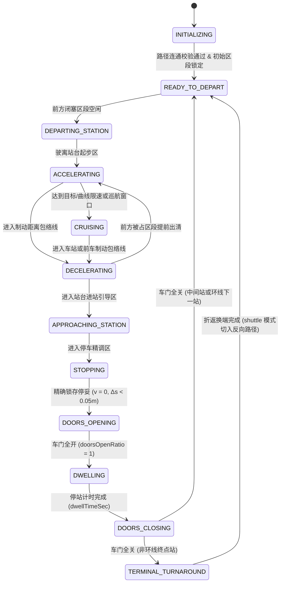

# SENKIRO Atlas v2 — Deterministic Train Simulation Engine (接口与架构文档)

> **系统定位与诚实性标识**：
> 本系统是 **虚拟确定性列车运行模拟引擎（Virtual Deterministic Train Simulation Engine）**，不接入真实时刻表、不生成真实列车实时位置，也绝不冒充运营商官方实时运行数据。
> 所有模拟配置、路径、列车快照与示例数据均强制携带显式标识：
> - `simulationLabel: "Simulation / 模拟运行"`
> - `dataNature: "synthetic"`
> - `isRealtimeData: false`

---

## 1. 模块结构与交付清单

模拟引擎全部位于 `labs/a-tokyo-atlas-fare/` 下，作为纯 TypeScript 领域模块（零 Three.js / React 耦合），直接复用 Session 0 的 `AtlasDataset`、`SolvedRailwayNetwork3D`、`TrackSegment`、`RailLine`、`Station` 与局部米制投影坐标系（`+X = East, +Y = Up, -Z = North`）：

| 文件路径 | 职责说明 |
| --- | --- |
| `src/domain/simulation/types.ts` | 8 层模拟领域模型、12 状态机枚举、可配置参数接口、向 3D 场景与 UI 输出的快照契约（`SimulationWorldSnapshot`, `SimulatedTrainSnapshot`, `SimulatedCarriagePose`） |
| `src/domain/simulation/rollingStockCatalog.ts` | 代表性日本铁路车型技术目录（JR E235-0、E233-0、东京地下铁 1000系/2000系/16000系、都营 12-600形、新干线 N700S、私铁 20m 通勤车）、虚拟编组构建器（`buildVirtualTrainConsist`）及物理约束参数校验 |
| `src/domain/simulation/trackSpline3D.ts` | 凸包圆角二次 Bézier 拟合的弧长参数化 3D 实体轨道曲线（`TrackSpline3D`，$O(\log N)$ 二分采样）与双转向架车厢三维姿态求解器（`solveConsistCarriagePoses`） |
| `src/domain/simulation/routeBuilder.ts` | Session 0 适配器（`Session0AtlasNetworkAdapter`）、复线左右行车中心线横向偏移（日本左行制 `-1.85m`）、轨道拓扑与 3D 空间连通性校验、站台停车点定位、闭塞分区切分（`buildRunnableTrackRoute`, `buildShuttleRoutePair`） |
| `src/domain/simulation/blockOccupancy.ts` | 多列车简化闭塞区段占用与移动安全间隔控制器（`BlockOccupancyController`），防止同轨重叠并支持单线双向互斥与复线同向追踪制动 |
| `src/domain/simulation/trainStateMachine.ts` | 单列车 12 状态确定性状态机（`SimulatedTrainInstance`），含曲线限速、制动曲线、精准停站锁存（误差 `< 0.05m`）、开关门/停站计时与终点折返换端 |
| `src/domain/simulation/simulationEngine.ts` | 模拟引擎主控（`TrainSimulationEngine`），实现固定时间步累加器（`fixedStepSec`）、暂停/恢复、时间倍率（`timeScale`）、多车发车队列与快照订阅 |
| `src/domain/simulation/mockAdapter.ts` | 独立 `MockRailwayNetworkAdapter`（单区间、90° 曲线高架过渡、环形闭环、断路/未连接轨道测试夹具）与 Session 0 东京多线预设装配器（`createTokyoAtlasSimulationEngine`） |
| `src/domain/simulation/index.ts` | 模拟引擎公共 API 统一导出入口 |
| `data/simulation/sample-simulation-presets.json` | 标记 `Simulation / 模拟运行` 的东京代表线路（山手线、银座线、丸之内线、中央线快速、都营大江户线）示例配置数据 |
| `tests/unit/trainSimulationEngine.test.ts` | 10 组自动化单元测试（覆盖单车 12 状态完整循环、15/30/60/120 FPS 跨帧率一致性、曲线与车厢间距、精准停车、终点折返与环线、断轨禁行、暂停与时间倍率、多车闭塞防撞、Session 0 东京 3D 路网集成） |

---

## 2. 模拟领域模型（8 层解耦）

引擎严格区分以下 8 个概念，**绝不将名义运营线路（`RailLine`）的 2D 地理折线直接当作列车行驶轨道**：

1. **实体轨道（`PhysicalTrackPathSegment`）**：由 Session 0 的 `TrackSegment` 与 `SolvedSegment3D` 派生，包含 3D 垂向层级（`L+2..L-4`）、工程结构类型（`viaduct | surface | tunnel_box | tunnel_shield`）、复线行车方向横向偏移（`directionalLateralOffsetM = -1.85m`）及物理区段 ID。
2. **运营线路（`SimulatedOperatingLine`）**：名义运营线路（`sk:line:*`）、运营商、线路色彩与站序。
3. **可运行路径（`RunnableTrackRoute`）**：经拓扑连通性与 3D 空间连续性校验（节点间隙 `<= 35m`）的有向实体轨道序列，包含总弧长 `totalLengthM`、有序站台停车目标 `stationStops` 与闭塞分区 `blocks`。若两站间无可靠 `TrackSegment` 连接或存在空间断层，`connectivity.valid = false`，严禁生成或运行列车。
4. **站点与站台（`SimulatedPlatformStop`）**：区分车站实体 ID（`sk:station:*`）与具体线路方向上的 3D 站台停车目标点（`platformId`, `stopArcLengthM`, `platformLengthM`, `tier`, `structure`）。
5. **方向与运行区间（`RunDirection` & `TrainLocationStatus`）**：支持 `'outbound' | 'inbound' | 'clockwise' | 'counterclockwise'`，以及 `'loop'`（闭环）、`'shuttle'`（往返折返）、`'one_way'`（单程终到）三种模式。
6. **车辆型号（`RollingStockSpec`）**：定义车体长度、车宽、车高、转向架中心距（`bogieCenterDistanceM`）、车钩车间隙（`interCarGapM`）、最高运营速度与常用/紧急加减速参数。
7. **虚拟列车编组（`VirtualTrainConsist`）**：由 `carCount` 节车厢组成，预计算每节车厢中心及前后转向架中心距列车头部的精确弧长偏移。
8. **运行状态（`TrainOperationalState`）**：12 状态确定性有限状态机。

---

## 3. 12 状态确定性状态机与固定时间步推进

每列车实例完整支持以下 **12 个状态**：

### 固定时间步累加器（Frame-Rate Independence）
- `engine.update(wallDeltaSec)` 将外部渲染帧间隔乘以 `timeScale` 后累加至内部 `accumulatorSec`，并严格以固定步长 `fixedStepSec`（默认 `0.05s = 20Hz`）推进物理与状态机。
- 无论渲染帧率为 `15 FPS`、`30 FPS`、`60 FPS`、`120 FPS` 或抖动帧率，相同模拟时长下的 `tickCount`、列车状态、速度与每节车厢 3D 坐标/四元数完全一致。

---

## 4. 3D 轨道运动与双转向架车厢姿态算法

1. **凸包圆角 3D 轨道曲线（`TrackSpline3D`）**：
   - 先折叠共线冗余采样点，再在折线拐点处构造位于相邻轨道点凸包内部的二次 Bézier 圆角过渡，确保切向量连续且高程 $y(s)$ 严格界于相邻轨道节点之间（**绝不悬空、绝不下穿地面、绝不横穿建筑或偏离轨道**）。
2. **双转向架弦线车厢姿态（`solveConsistCarriagePoses`）**：
   - 对编组第 $k$ 节车厢，分别在 3D 轨道弧长 $s_{\text{frontBogie}}(k)$ 与 $s_{\text{rearBogie}}(k)$ 处采样前后转向架中心的三维坐标 $\mathbf{P}_F, \mathbf{P}_R$。
   - 车体朝向向量由后转向架指向前转向架：$\mathbf{f} = \text{normalize}(\mathbf{P}_F - \mathbf{P}_R)$，由此导出正交基 $[\mathbf{r}, \mathbf{u}, \mathbf{f}]$、欧拉角（`yawRad`, `pitchRad`, `rollRad`）与单位四元数 `quaternion: [qx, qy, qz, qw]`。
   - 车厢几何中心位于前后转向架中点（垂向与车体中心轨道高程平滑融合），在通过急曲线与高架/地下坡度过渡段时始终保持准确的转向架内切姿态与恒定车厢间距。

---

## 5. 跨 Session 协作接口规范

### 5.1 供 Rolling Stock Session（车辆 3D 模型资产）对接
3D 场景渲染层在每帧调用 `const world = engine.update(dtSec)` 后，遍历 `world.trains`：
- `train.rollingStockId` / `train.modelCode`：匹配对应的日本列车 3D 模型资产（如 `'sk:rolling-stock:jre-e235-yamanote'` -> E235 系，`'sk:rolling-stock:metro-1000-ginza'` -> 银座线 1000 系）。
- `train.carriages`：数组内每个元素 `car` 提供单节车厢的完整变换：
  - `car.position`: `{ x, y, z }`（直接赋给车厢 `Mesh/Group.position`，若开启视觉竖向夸张则将 `y` 乘以 `verticalExaggeration`）。
  - `car.orientation.quaternion`: `[qx, qy, qz, qw]`（直接赋给车厢 `Mesh/Group.quaternion`，局部坐标系约定：`+X = 右侧`, `+Y = 车顶向上`, `+Z = 车头前进方向`）。
  - `car.frontBogiePosition` / `car.rearBogiePosition`：可供精细转向架子网格独立定位。
  - `car.role`: `'cab_lead' | 'motor_mid' | 'trailer_mid' | 'cab_tail'`（区分头尾驾驶室车厢与中间带受电弓动车/拖车）。
- `train.doorsOpenRatio`: `0..1`（驱动站台停靠时的车门开闭动画）。

### 5.2 供 Camera / UI Session（相机追踪与控制面板）对接
- **控制 API**：
  - `engine.pause()` / `engine.resume()` / `engine.setPaused(bool)`
  - `engine.setTimeScale(multiplier)`（如 `0.5`, `1`, `2`, `5`, `10`）
  - `engine.updateConfig({ headwaySec, dwellTimeSec, minSafeSeparationM, maxActiveTrains })`
  - `engine.subscribe((snapshot) => { ... })`
- **状态与诚实性展示字段**：
  - 面板顶部或列车徽章必须展示 `snapshot.simulationLabel`（`"Simulation / 模拟运行"`）。
  - `train.state`（12 状态枚举）、`train.speedKph`、`train.direction`、`train.lineId`。
  - `train.locationStatus`：
    - `kind`: `'at_station' | 'inter_station'`
    - `currentStationNameJa` / `currentStationNameEn`（停站时）
    - `fromStationNameJa` -> `toStationNameJa`、`intervalProgress01`、`distanceToNextStationM`（区间运行时）
    - `currentTier`（`L+2..L-4`）与 `currentStructure`（`viaduct | surface | tunnel_box | tunnel_shield`）。
